<div align="center">

# react-native-otp-studio

**Beautiful, customizable OTP input for React Native**

Circle · Square · Rounded · Pill · Underline · Glass effect · Colors · Shadows · Any length · Any type

[](https://www.npmjs.com/package/react-native-otp-studio)
[](https://www.npmjs.com/package/react-native-otp-studio)
[](LICENSE)


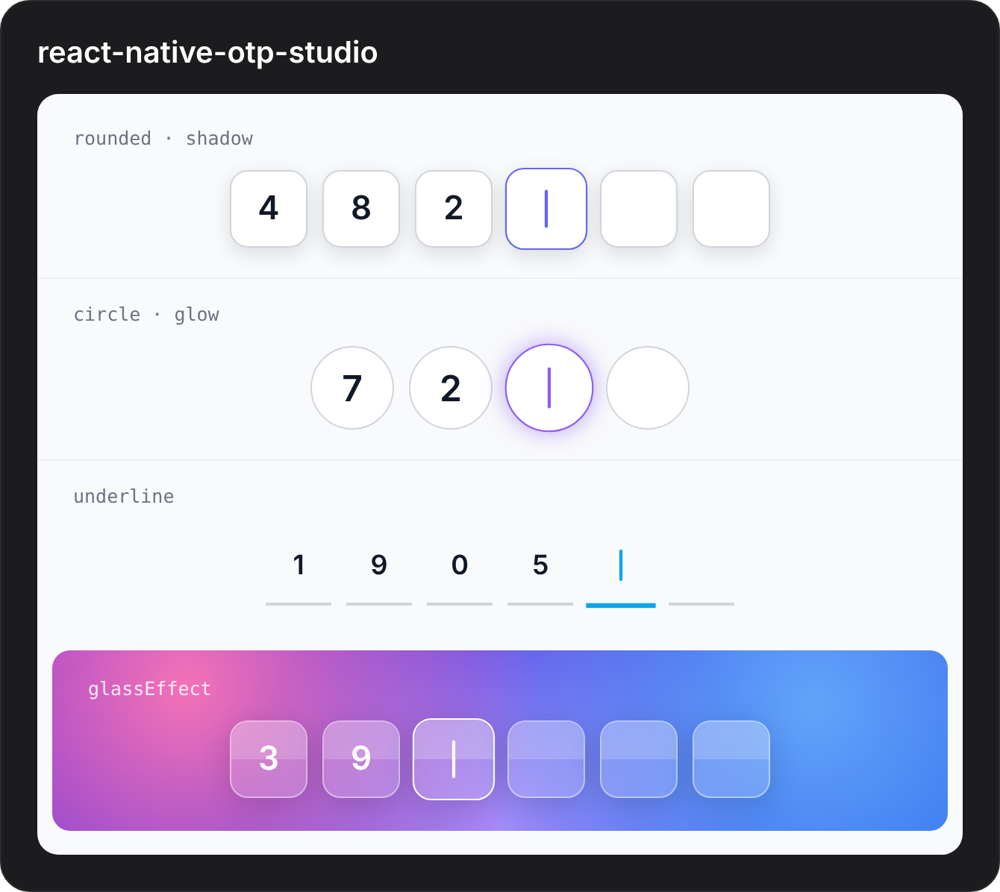

</div>

---

## Contents

- [Why this package](#why-this-package)
- [Install](#install)
- [Quick start](#quick-start)
- [Length](#length)
- [Shapes](#shapes)
- [Glass effect](#glass-effect)
- [Colors](#colors)
- [Shadow and glow](#shadow-and-glow)
- [Position](#position)
- [Size and spacing](#size-and-spacing)
- [Input types](#input-types)
- [Mask (PIN)](#mask-pin)
- [Groups and separators](#groups-and-separators)
- [Placeholder](#placeholder)
- [States: active, filled, error, disabled](#states-active-filled-error-disabled)
- [Animations and cursor](#animations-and-cursor)
- [Controlled value and events](#controlled-value-and-events)
- [Ref methods](#ref-methods)
- [Custom styles](#custom-styles)
- [Fully custom cell (`renderCell`)](#fully-custom-cell-rendercell)
- [SMS autofill and paste](#sms-autofill-and-paste)
- [Full example: verify screen](#full-example-verify-screen)
- [All props](#all-props)
- [TypeScript types](#typescript-types)
- [FAQ and notes](#faq-and-notes)

---

## Why this package

| | |
| --- | --- |
| 🪶 **Lightweight** | Zero dependencies, pure JS, about 28 kB packed |
| 📱 **Works everywhere** | iOS, Android, **Expo Go**, bare React Native. No native linking, no `pod install` |
| 🔷 **5 shapes** | `square`, `rounded`, `circle`, `pill`, `underline` (Instagram / Telegram style) |
| 🧊 **Glass effect** | One prop: `glassEffect`. Light and dark tint, optional real blur |
| 🎨 **Every color** | Text, background, border, active, filled, error, cursor, placeholder |
| 🔢 **Any length and type** | Numeric, letters, alphanumeric, hex, masked, custom RegExp |
| 📩 **SMS autofill** | iOS one-time code and Android SMS suggestions; paste works too |
| ✨ **Animated** | Active box pop, blinking cursor, shake on error |
| 🟦 **TypeScript** | Full types included |

---

## Install

```bash
npm install react-native-otp-studio
```

```bash
yarn add react-native-otp-studio
```

```bash
npx expo install react-native-otp-studio
```

There are no extra steps. You don't need to link anything, run `pod install` or rebuild.

---

## Quick start

```tsx
import { OtpInput } from "react-native-otp-studio";

export default function VerifyScreen() {
  return (
    <OtpInput
      length={6}
      autoFocus
      onComplete={(code) => console.log("OTP:", code)}
    />
  );
}
```

`onComplete` fires once every box is filled. Use it to call your verify API.

---

## Length

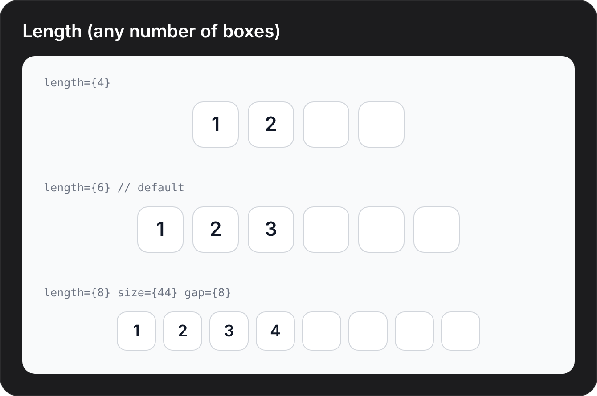

```tsx
<OtpInput length={4} />                    // 4-digit code
<OtpInput length={6} />                    // default
<OtpInput length={8} size={44} gap={8} />  // smaller boxes for long codes
```

**Default:** `length = 6`. Any positive number works.

> **Tip:** for 7 or more boxes on small phones, lower `size` and `gap` so the row fits the screen.

---

## Shapes

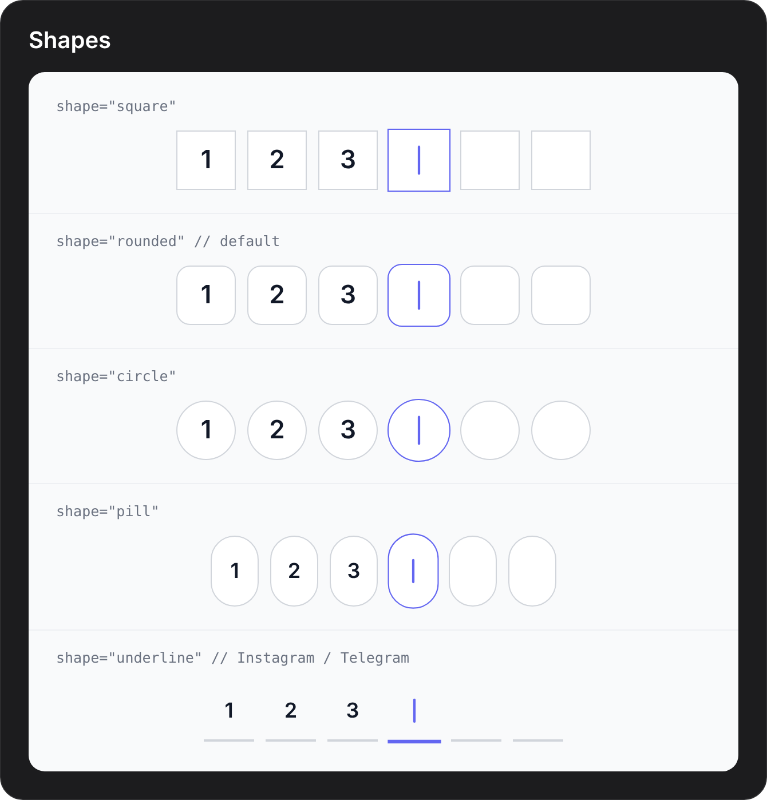

```tsx
<OtpInput shape="square" />     // sharp corners
<OtpInput shape="rounded" />    // default, soft corners
<OtpInput shape="circle" />     // round boxes
<OtpInput shape="pill" />       // tall capsule
<OtpInput shape="underline" />  // only a line under each digit (Instagram / Telegram)
```

| Shape | Width × height (size = 52) | Corner radius | Border |
| --- | --- | --- | --- |
| `square` | 52 × 52 | 0 | all sides |
| `rounded` (default) | 52 × 52 | 24% of size (12) | all sides |
| `circle` | 52 × 52 | 50% (26) | all sides |
| `pill` | 42 × 62 | full | all sides |
| `underline` | 44 × 52 | 0 | bottom only, transparent background |

You can still override any of them with `borderRadius`, `cellWidth`, `cellHeight` or `borderWidth`.

---

## Glass effect

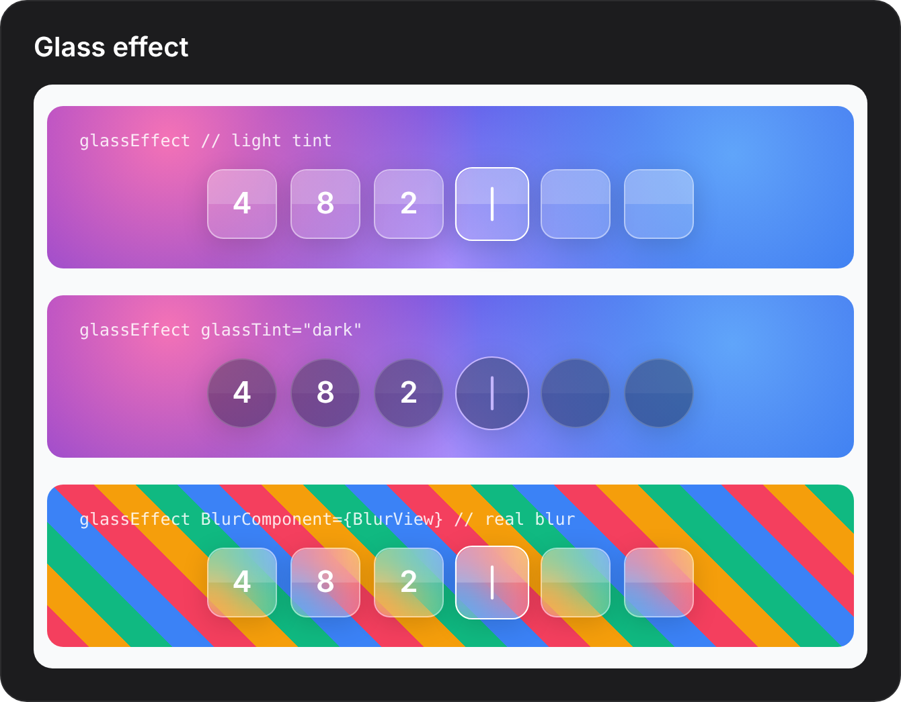

```tsx
// 1. Light glass (default tint)
<OtpInput glassEffect textColor="#fff" activeBorderColor="#fff" />

// 2. Dark glass
<OtpInput glassEffect glassTint="dark" shape="circle" />

// 3. Change how see-through it is (0 = clear, 1 = solid)
<OtpInput glassEffect glassOpacity={0.3} />

// 4. Real blur: pass a blur view you already use
import { BlurView } from "expo-blur";                    // Expo
// import { BlurView } from "@react-native-community/blur"; // bare RN

<OtpInput glassEffect BlurComponent={BlurView} blurIntensity={40} />
```

| Prop | Default | What it does |
| --- | --- | --- |
| `glassEffect` | `false` | Turns on the frosted glass look |
| `glassTint` | `"light"` | `"light"` = white frost, `"dark"` = smoky frost with white text |
| `glassOpacity` | `0.18` | How solid the glass fill is (0–1) |
| `BlurComponent` | none | Optional real blur component, rendered inside each box |
| `blurIntensity` | `30` | Sent to `BlurComponent` as `intensity` (expo-blur) and `blurAmount` (community blur) |

With `glassEffect` on, the box gets a translucent fill, a light border with a brighter top rim, and (on iOS) a soft shadow. On Android, glass cells never use `elevation`, because Android draws that shadow behind the translucent fill and it shows through as a dark inner square. **No extra dependency is needed.** `BlurComponent` only adds a true background blur on top.

> **Tip:** glass looks best over an image, gradient or colorful background. On a plain white screen, use `glassTint="dark"`.

---

## Colors

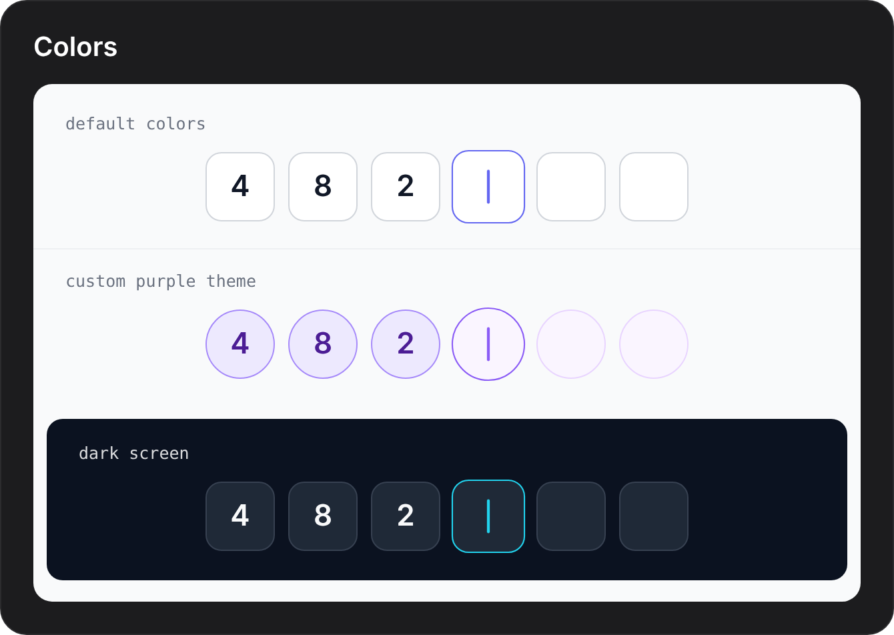

```tsx
<OtpInput
  shape="circle"
  textColor="#4C1D95"              // digit color
  backgroundColor="#FAF5FF"        // empty box
  borderColor="#E9D5FF"            // empty box border
  activeBorderColor="#8B5CF6"      // focused box border
  activeBackgroundColor="#FFFFFF"  // focused box background
  filledBorderColor="#A78BFA"      // boxes that have a digit
  filledBackgroundColor="#EDE9FE"
  errorColor="#EF4444"             // border + cursor when error
  cursorColor="#8B5CF6"            // blinking cursor
  placeholderTextColor="#C4B5FD"
/>

// Dark screen
<OtpInput
  textColor="#F9FAFB"
  backgroundColor="#1F2937"
  borderColor="#374151"
  activeBorderColor="#22D3EE"
/>
```

**Defaults:**

| Prop | Default |
| --- | --- |
| `textColor` | `#111827` (white for dark glass) |
| `backgroundColor` | `#FFFFFF` (transparent for `underline`) |
| `borderColor` | `#D1D5DB` |
| `activeBorderColor` | `#6366F1` |
| `filledBorderColor` / `filledBackgroundColor` / `activeBackgroundColor` | same as normal |
| `errorColor` | `#EF4444` |
| `cursorColor` | same as `activeBorderColor` |
| `placeholderTextColor` | `#9CA3AF` |

**Which color wins:** error › active › filled › normal.

---

## Shadow and glow

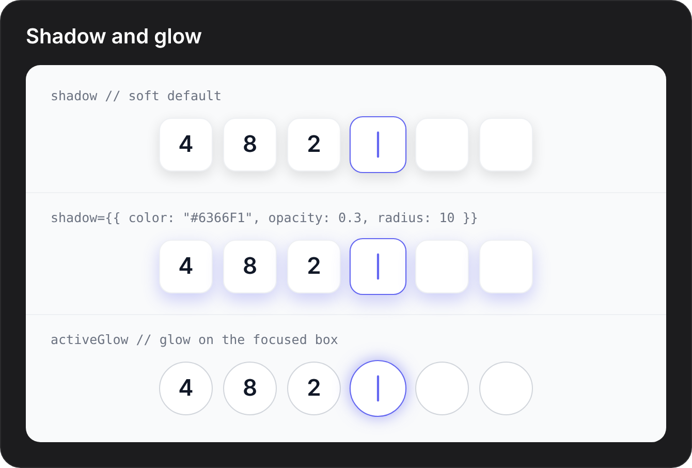

```tsx
// Soft default shadow
<OtpInput shadow />

// Custom shadow
<OtpInput
  shadow={{
    color: "#6366F1",
    opacity: 0.3,
    radius: 10,
    offset: { width: 0, height: 6 },
    elevation: 6, // Android
  }}
/>

// Glow only around the focused box
<OtpInput activeGlow shape="circle" />
```

| Prop | Default | Notes |
| --- | --- | --- |
| `shadow` | `false` | `true` = `{ color: "#000", opacity: 0.12, radius: 8, offset: { width: 0, height: 4 }, elevation: 4 }` |
| `activeGlow` | `false` | Glow in `activeBorderColor` (or `errorColor` on error) around the focused box |

> **Android:** shadows need a solid `backgroundColor`. This is a React Native rule. The default white works. `underline` has no shadow.

---

## Position

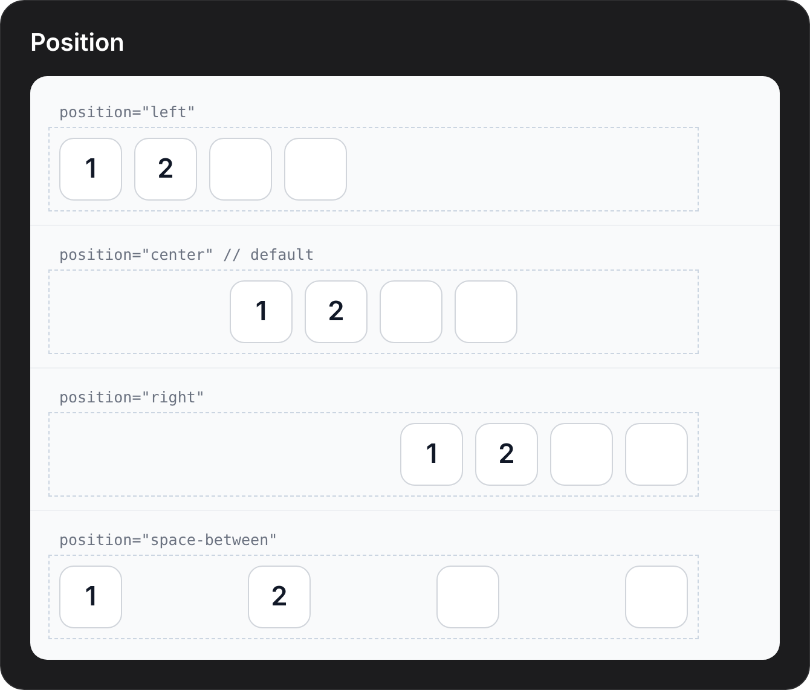

```tsx
<OtpInput position="left" />
<OtpInput position="center" />         // default
<OtpInput position="right" />
<OtpInput position="space-between" />  // spread across full width
<OtpInput position="space-around" />
<OtpInput position="space-evenly" />
```

**Default:** `position = "center"`. Spacing values use the full width of the parent. Set the width with `containerStyle={{ width: "100%" }}` or a padding on the parent.

To move the whole input on the screen, use `containerStyle`:

```tsx
<OtpInput containerStyle={{ marginTop: 40, paddingHorizontal: 24 }} />
```

---

## Size and spacing

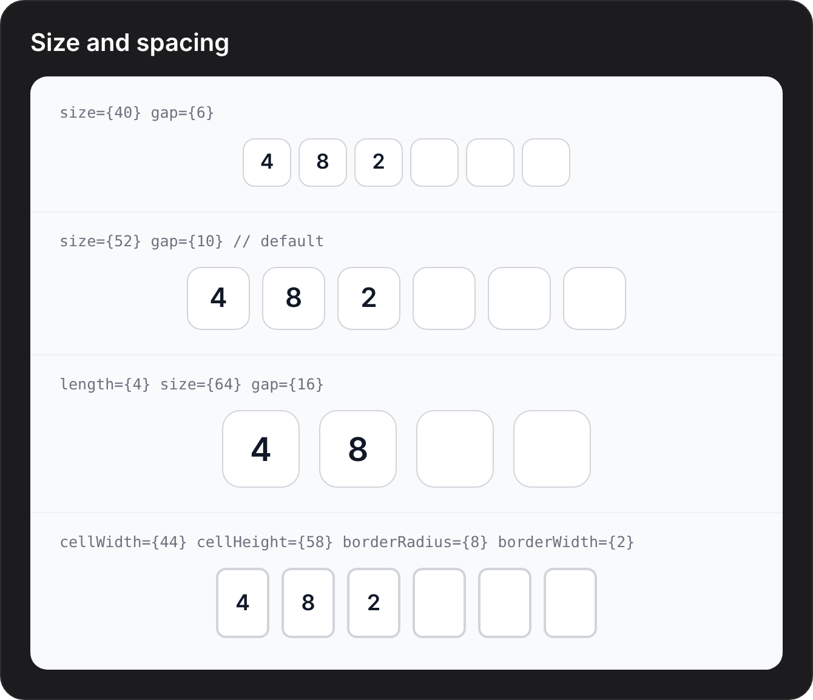

```tsx
<OtpInput size={40} gap={6} />                 // compact
<OtpInput size={52} gap={10} />                // default
<OtpInput length={4} size={64} gap={16} />     // big PIN
<OtpInput cellWidth={44} cellHeight={58} borderRadius={8} borderWidth={2} />  // exact control
<OtpInput fontSize={28} fontWeight="700" fontFamily="Inter-Bold" />           // digit text
```

| Prop | Default | Notes |
| --- | --- | --- |
| `size` | `52` | Base size. The shape decides width and height from it |
| `cellWidth` / `cellHeight` | from shape | Override exact width / height |
| `gap` | `10` | Space between boxes |
| `borderRadius` | from shape | Override corners |
| `borderWidth` | `1.5` (`2` for underline) | Underline gets +1 when focused |
| `fontSize` | 42% of box | Auto-scales with `size` |
| `fontWeight` | `"600"` | |
| `fontFamily` | system | |

---

## Input types

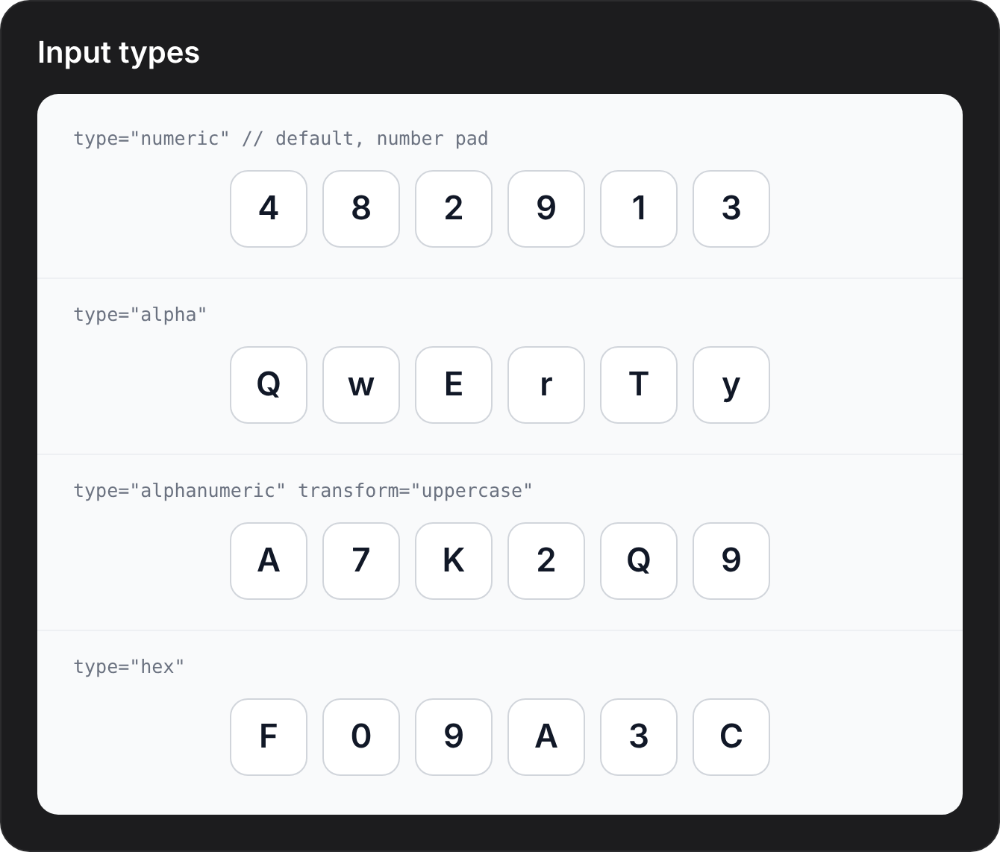

```tsx
<OtpInput type="numeric" />                              // 0-9, number pad (default)
<OtpInput type="alpha" />                                // a-z, A-Z
<OtpInput type="alphanumeric" />                         // letters + numbers
<OtpInput type="alphanumeric" transform="uppercase" />   // typed "a7k" shows "A7K"
<OtpInput type="hex" />                                  // 0-9, a-f
<OtpInput type="any" />                                  // anything except spaces

// Your own rule, checked one character at a time
<OtpInput type={/^[A-F0-5]$/} transform="uppercase" />
<OtpInput type={(char) => "XYZ".includes(char)} />
```

| `type` | Allowed | Keyboard |
| --- | --- | --- |
| `"numeric"` (default) | `0-9` | number pad |
| `"alpha"` | `a-z A-Z` | default |
| `"alphanumeric"` | `a-z A-Z 0-9` | default |
| `"hex"` | `0-9 a-f A-F` | default |
| `"any"` | any non-space | default |
| `RegExp` | chars matching it | default |
| `(char) => boolean` | chars where it returns `true` | default |

| `transform` | Effect |
| --- | --- |
| `"none"` (default) | keep as typed |
| `"uppercase"` | `a` → `A` (also sets keyboard to caps) |
| `"lowercase"` | `A` → `a` |
| `(char) => string` | your own |

Invalid characters are ignored. Nothing appears when you type them.

---

## Mask (PIN)

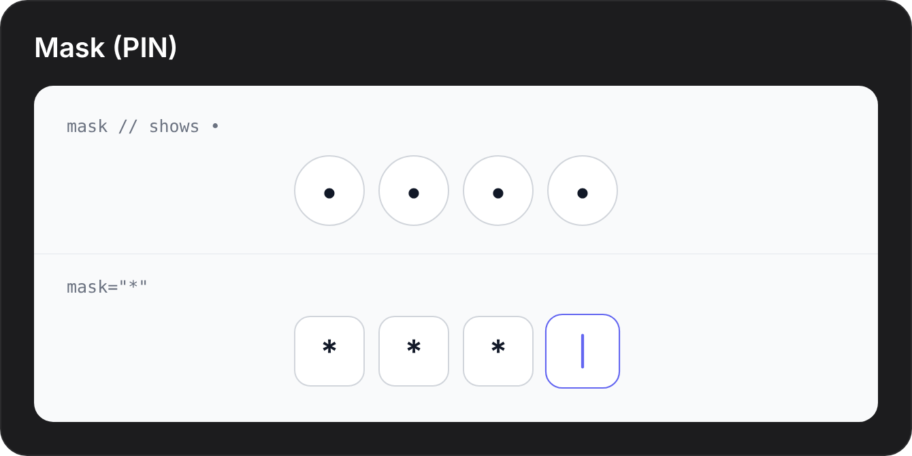

```tsx
<OtpInput length={4} mask shape="circle" />  // shows •
<OtpInput length={4} mask="*" />             // shows *
<OtpInput mask="●" />                        // any character
```

The real value still goes to `onChange` and `onComplete`. Only the display is hidden.

---

## Groups and separators

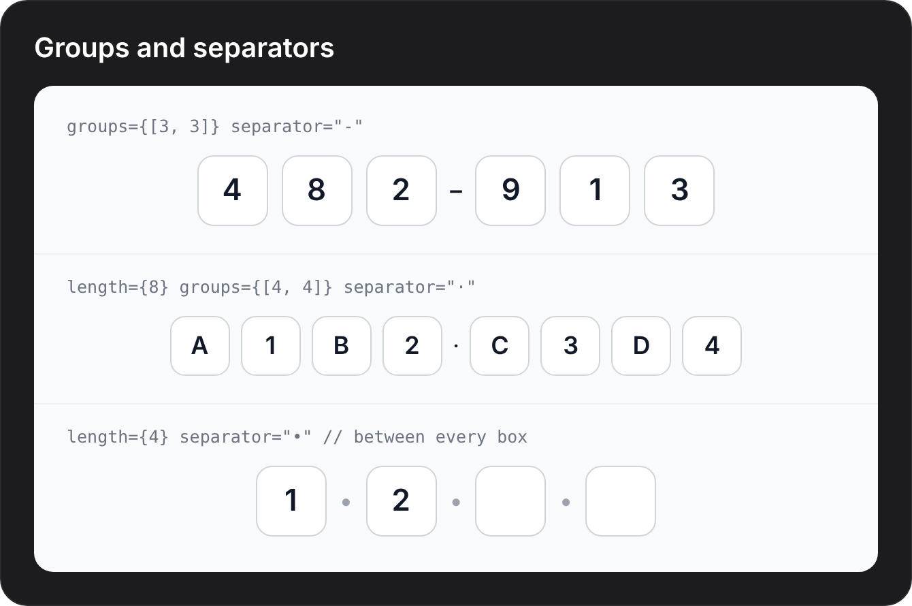

```tsx
<OtpInput length={6} groups={[3, 3]} separator="-" />       // 482 - 913
<OtpInput length={8} groups={[4, 4]} separator="·" />       // ABCD · 1234
<OtpInput length={9} groups={[3, 3, 3]} separator="-" />
<OtpInput length={4} separator="•" />                        // between every box
<OtpInput groups={[3, 3]} separator={<MyDivider />} />       // any component
```

- `groups` must add up to `length`.
- Without `groups`, the separator shows between every box.
- A string separator uses the text color. Pass a component for full control.

---

## Placeholder

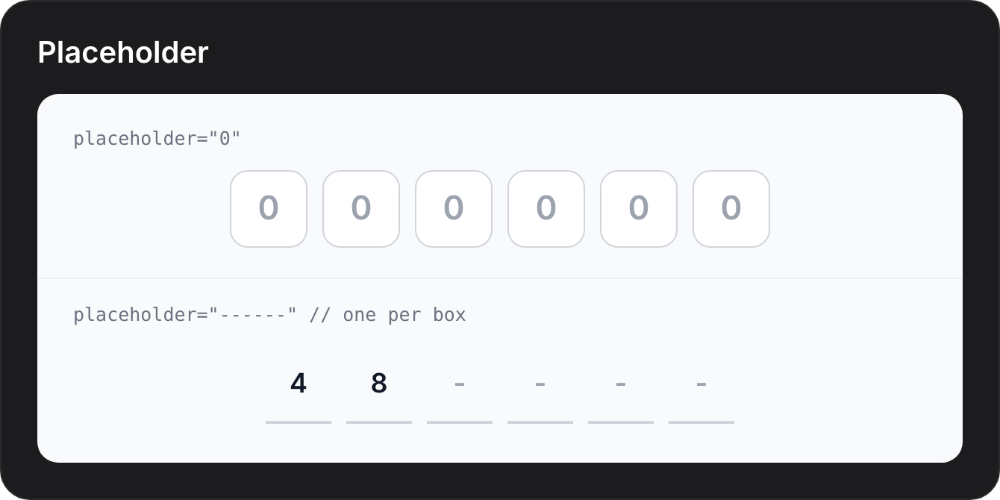

```tsx
<OtpInput placeholder="0" />                          // same char in every empty box
<OtpInput placeholder="------" shape="underline" />   // one char per box (length must match)
<OtpInput placeholder="0" placeholderTextColor="#CBD5E1" />
```

---

## States: active, filled, error, disabled

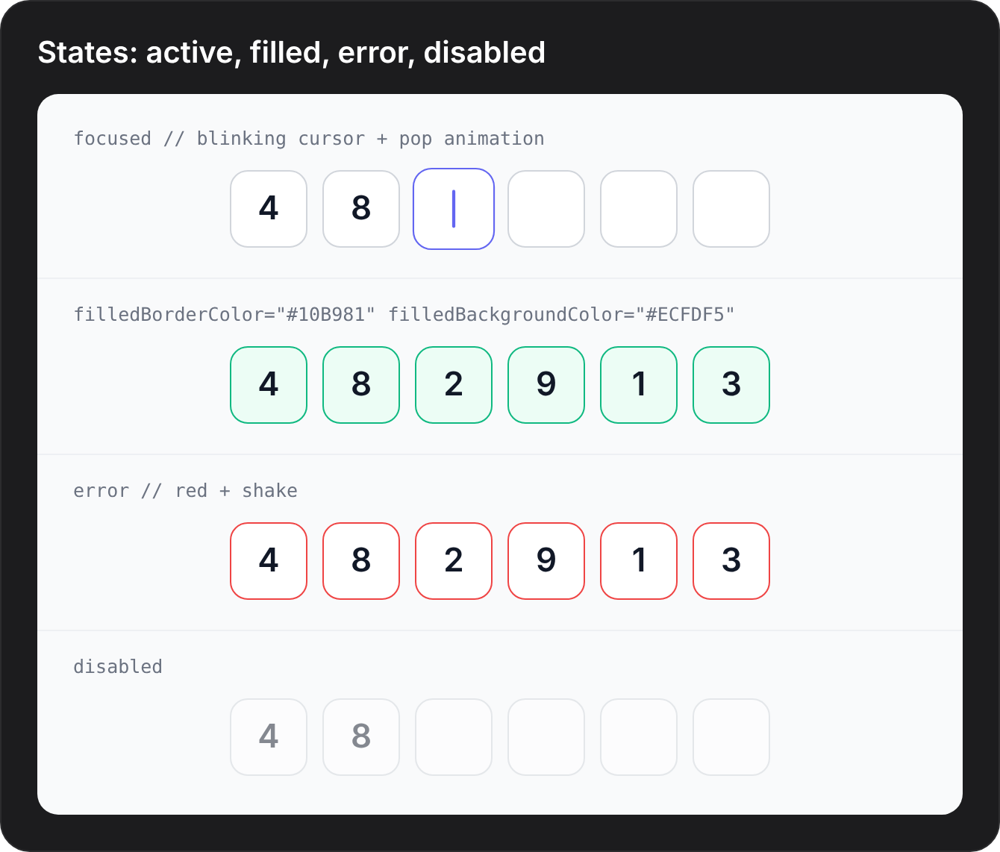

```tsx
// Focused: active border + blinking cursor + small pop (automatic)
<OtpInput autoFocus />

// Filled boxes look different
<OtpInput filledBorderColor="#10B981" filledBackgroundColor="#ECFDF5" />

// Error: red borders + shake animation
<OtpInput error={isWrong} />

// Disabled: faded, can't type
<OtpInput disabled />
```

| Prop | Default | Notes |
| --- | --- | --- |
| `autoFocus` | `false` | Opens the keyboard on mount |
| `error` | `false` | Uses `errorColor` and shakes once when it turns `true` |
| `disabled` | `false` | 50% opacity, not editable |
| `blurOnComplete` | `false` | Closes the keyboard when all boxes are filled |

---

## Animations and cursor

```tsx
<OtpInput animated={false} />     // no pop on the active box
<OtpInput showCursor={false} />   // no blinking cursor
<OtpInput shakeOnError={false} /> // no shake when error turns true
```

| Prop | Default | Animation |
| --- | --- | --- |
| `animated` | `true` | Active box scales to 1.06 with a spring |
| `showCursor` | `true` | Cursor blinks in the active empty box |
| `shakeOnError` | `true` | Row shakes left and right in 300 ms |

All animations use the native driver.

---

## Controlled value and events

```tsx
const [code, setCode] = useState("");

<OtpInput
  value={code}                       // controlled
  onChange={setCode}                 // every change
  onComplete={(v) => verify(v)}      // all boxes filled
  onFocus={() => console.log("focus")}
  onBlur={() => console.log("blur")}
/>

// Uncontrolled with a starting value
<OtpInput defaultValue="12" />
```

| Event | When |
| --- | --- |
| `onChange(value)` | Any change (type, delete, paste, autofill, `setValue`, `clear`) |
| `onComplete(value)` | The value reaches `length` characters |
| `onFocus()` / `onBlur()` | Keyboard opens / closes |

---

## Ref methods

```tsx
import { OtpInput, type OtpInputRef } from "react-native-otp-studio";

const otpRef = useRef<OtpInputRef>(null);

<OtpInput ref={otpRef} />

otpRef.current?.focus();             // open keyboard
otpRef.current?.blur();              // close keyboard
otpRef.current?.clear();             // empty all boxes
otpRef.current?.setValue("123456");  // fill (invalid chars are dropped)
otpRef.current?.getValue();          // "123456"
```

---

## Custom styles

All style props are merged last, so they override everything:

```tsx
<OtpInput
  containerStyle={{ marginVertical: 24 }}          // outer wrapper
  cellStyle={{ borderStyle: "dashed" }}            // every box
  activeCellStyle={{ borderWidth: 2 }}             // focused box
  filledCellStyle={{ backgroundColor: "#F0FDF4" }} // boxes with a digit
  errorCellStyle={{ borderWidth: 2 }}              // when error
  textStyle={{ letterSpacing: 1 }}                 // digit text
/>
```

Pass extra props to the hidden `TextInput`:

```tsx
<OtpInput textInputProps={{ returnKeyType: "done", onSubmitEditing: submit }} />
```

---

## Fully custom cell (`renderCell`)

Draw each box yourself. The library still handles typing, paste, autofill and focus.

```tsx
<OtpInput
  length={4}
  renderCell={({ index, char, displayChar, isActive, isFilled, hasError }) => (
    <View
      key={index}
      style={{
        width: 56,
        height: 56,
        borderRadius: 16,
        alignItems: "center",
        justifyContent: "center",
        backgroundColor: isFilled ? "#111827" : "#F3F4F6",
        borderWidth: 2,
        borderColor: hasError ? "red" : isActive ? "#6366F1" : "transparent",
      }}
    >
      <Text style={{ color: "#fff", fontSize: 24 }}>{displayChar}</Text>
    </View>
  )}
/>
```

`displayChar` is the mask character when `mask` is on. `char` is always the real character.

---

## SMS autofill and paste

It works out of the box, with no setup:

| Platform | How |
| --- | --- |
| **iOS** | `textContentType="oneTimeCode"`: the code from Messages shows above the keyboard. Tap it and all boxes fill |
| **Android** | `autoComplete="sms-otp"`: Google keyboard / SMS suggestions fill the code |
| **Paste** | Long-press and paste. `"Your code is 482-913"` becomes `482913` (only valid chars are kept) |

---

## Full example: verify screen

```tsx
import { useRef, useState } from "react";
import { Text, View } from "react-native";
import { OtpInput, type OtpInputRef } from "react-native-otp-studio";

export default function VerifyScreen() {
  const otpRef = useRef<OtpInputRef>(null);
  const [error, setError] = useState(false);

  const verify = async (code: string) => {
    const ok = await api.verifyOtp(code);
    if (!ok) {
      setError(true);                              // red + shake
      setTimeout(() => otpRef.current?.clear(), 600);
    }
  };

  return (
    <View style={{ flex: 1, justifyContent: "center", padding: 24 }}>
      <Text style={{ fontSize: 22, fontWeight: "700", textAlign: "center" }}>Enter code</Text>
      <Text style={{ color: "#6B7280", textAlign: "center", marginVertical: 12 }}>
        We sent a 6-digit code to +91 98765 43210
      </Text>

      <OtpInput
        ref={otpRef}
        length={6}
        shape="rounded"
        shadow
        activeGlow
        autoFocus
        error={error}
        onChange={() => setError(false)}
        onComplete={verify}
      />

      {error && <Text style={{ color: "#EF4444", textAlign: "center", marginTop: 12 }}>Wrong code, try again</Text>}
    </View>
  );
}
```

See [`example/App.tsx`](example/App.tsx) for every style on one screen.

---

## All props

| Prop | Type | Default | Description |
| --- | --- | --- | --- |
| **Value** | | | |
| `length` | `number` | `6` | Number of boxes |
| `value` | `string` | | Controlled value |
| `defaultValue` | `string` | | Starting value (uncontrolled) |
| `onChange` | `(value: string) => void` | | Every change |
| `onComplete` | `(value: string) => void` | | All boxes filled |
| `onFocus` / `onBlur` | `() => void` | | Focus events |
| **Type** | | | |
| `type` | `"numeric" \| "alpha" \| "alphanumeric" \| "hex" \| "any" \| RegExp \| (c) => boolean` | `"numeric"` | Allowed characters |
| `transform` | `"none" \| "uppercase" \| "lowercase" \| (c) => string` | `"none"` | Change chars before checking |
| `mask` | `boolean \| string` | `false` | Hide characters |
| **Shape and size** | | | |
| `shape` | `"square" \| "rounded" \| "circle" \| "pill" \| "underline"` | `"rounded"` | Box shape |
| `size` | `number` | `52` | Base box size |
| `cellWidth` / `cellHeight` | `number` | from shape | Exact box size |
| `gap` | `number` | `10` | Space between boxes |
| `borderRadius` | `number` | from shape | Corner radius |
| `borderWidth` | `number` | `1.5` / `2` | Border thickness |
| `position` | `"center" \| "left" \| "right" \| "space-between" \| "space-around" \| "space-evenly"` | `"center"` | Alignment |
| **Colors** | | | |
| `textColor` | `string` | `#111827` | Digit color |
| `backgroundColor` | `string` | `#FFFFFF` | Box background |
| `activeBackgroundColor` | `string` | | Focused box background |
| `filledBackgroundColor` | `string` | | Filled box background |
| `borderColor` | `string` | `#D1D5DB` | Border |
| `activeBorderColor` | `string` | `#6366F1` | Focused border |
| `filledBorderColor` | `string` | | Filled border |
| `errorColor` | `string` | `#EF4444` | Error border and cursor |
| `cursorColor` | `string` | `activeBorderColor` | Cursor |
| `placeholderTextColor` | `string` | `#9CA3AF` | Placeholder |
| **Effects** | | | |
| `shadow` | `boolean \| OtpShadow` | `false` | Box shadow |
| `activeGlow` | `boolean` | `false` | Glow on focused box |
| `glassEffect` | `boolean` | `false` | Frosted glass |
| `glassTint` | `"light" \| "dark"` | `"light"` | Glass tint |
| `glassOpacity` | `number` | `0.18` | Glass fill (0–1) |
| `BlurComponent` | `ComponentType` | | Real blur view |
| `blurIntensity` | `number` | `30` | Blur strength |
| **Text** | | | |
| `fontSize` | `number` | auto | Digit size |
| `fontWeight` | `TextStyle["fontWeight"]` | `"600"` | |
| `fontFamily` | `string` | | |
| `placeholder` | `string` | | One char, or one per box |
| **Behaviour** | | | |
| `separator` | `ReactNode` | | Between boxes / groups |
| `groups` | `number[]` | | Group sizes |
| `error` | `boolean` | `false` | Error state |
| `disabled` | `boolean` | `false` | Disable input |
| `autoFocus` | `boolean` | `false` | Focus on mount |
| `blurOnComplete` | `boolean` | `false` | Close keyboard when done |
| `showCursor` | `boolean` | `true` | Blinking cursor |
| `animated` | `boolean` | `true` | Pop animation |
| `shakeOnError` | `boolean` | `true` | Shake on error |
| **Styles** | | | |
| `containerStyle` | `ViewStyle` | | Wrapper |
| `cellStyle` | `ViewStyle` | | Every box |
| `activeCellStyle` | `ViewStyle` | | Focused box |
| `filledCellStyle` | `ViewStyle` | | Filled boxes |
| `errorCellStyle` | `ViewStyle` | | Error boxes |
| `textStyle` | `TextStyle` | | Digit text |
| **Advanced** | | | |
| `renderCell` | `(state: OtpCellState) => ReactNode` | | Custom box |
| `textInputProps` | `TextInputProps` | | Hidden input props |
| `testID` | `string` | `"otp-input"` | Cells: `otp-input-cell-0`…, input: `otp-input-hidden` |

---

## TypeScript types

```ts
import type {
  OtpInputProps,  // all props
  OtpInputRef,    // { focus, blur, clear, setValue, getValue }
  OtpCellState,   // { index, char, displayChar, isActive, isFilled, hasError }
  OtpShape,       // "square" | "rounded" | "circle" | "pill" | "underline"
  OtpPosition,    // "center" | "left" | "right" | "space-between" | ...
  OtpShadow,      // { color, opacity, radius, offset, elevation }
  OtpType,
  OtpTransform,
} from "react-native-otp-studio";
```

---

## FAQ and notes

**Does it work with Expo?**
Yes, including Expo Go. It is pure JavaScript.

**Shadow doesn't show on Android.**
Android needs a solid `backgroundColor` for `elevation`. Don't use `transparent` with `shadow`.

**Glass looks plain white.**
Glass is see-through, so it needs something colorful behind it (an image or gradient). Try `glassTint="dark"`, or add `BlurComponent`.

**The row is wider than the screen.**
Lower `size` and `gap`, for example `length={8} size={40} gap={6}`.

**How do I test it?**
Use these test IDs: `otp-input-hidden` (the input, use `fireEvent.changeText`) and `otp-input-cell-0`…

**Which versions does it support?**
React Native 0.70+ and React 18+.

---

## Contributing

```bash
git clone https://github.com/vasanthakumar2k/react-native-otp-studio.git
cd react-native-otp-studio
npm install
npm test          # jest
npm run typecheck
npm run build
```

Issues and PRs are welcome: [GitHub Issues](https://github.com/vasanthakumar2k/react-native-otp-studio/issues)

## Author

**Vasanthakumar A**
📧 [2002vasanthakumar@gmail.com](mailto:2002vasanthakumar@gmail.com)
🐙 [@vasanthakumar2k](https://github.com/vasanthakumar2k)

## License

MIT © Vasanthakumar A
